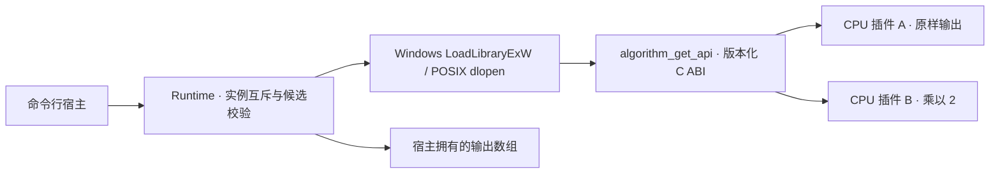

# Algorithm DLL Switching Demo

C++17 动态算法插件的最小运行闭环：**加载插件 A → 执行 → 切换插件 B → 执行 → 释放**。默认构建不依赖 Qt、OpenCV、CUDA、TensorRT 或模型文件；Windows 使用 DLL，macOS/Linux 使用动态库。

两个 CPU 插件分别将浮点数组原样输出、乘以 2，用于验证部署契约与切换行为，不代表已经集成模型推理。原有 Qt 算法加载代码保留为 legacy，尚未接入这个新运行时。

## 已实现架构



- ABI 用定长整数、函数表和不透明实例指针，不跨库传递 STL 对象；同进程插件仍须匹配体系结构与调用约定。
- 装载候选库后检查入口、ABI 版本、函数表和实例创建，再做一元素预执行；成功后才替换旧实例。
- 失败候选自动清理，旧插件保持可调用；实例先销毁，动态库后卸载。
- 同一 Runtime 的处理、切换和释放串行化，确保处理期间不会卸载库。当前不是无停顿实时切换；调用者须在销毁 Runtime 前停止并发访问。
- 插件必须同步完成调用、返回状态码且不得抛异常跨越 C ABI。进程内插件不提供崩溃隔离；仅加载可信库。

## 构建、运行与测试

需要 CMake 3.16+、C++17 编译器。Windows 使用 Visual Studio 2022 C++ x64 开发者终端；macOS 使用 Xcode Command Line Tools；Linux 使用 GCC/Clang。

```sh
cmake -S . -B build -DCMAKE_BUILD_TYPE=Release
cmake --build build --config Release
ctest --test-dir build -C Release --output-on-failure
```

macOS：

```sh
./build/algorithm_demo ./build/libcpu_reference_a.dylib ./build/libcpu_reference_b.dylib
```

Linux：

```sh
./build/algorithm_demo ./build/libcpu_reference_a.so ./build/libcpu_reference_b.so
```

Windows（Visual Studio 多配置生成器）：

```powershell
.\build\Release\algorithm_demo.exe .\build\Release\cpu_reference_a.dll .\build\Release\cpu_reference_b.dll
```

预期输出：

```text
A: 1 2 3
B: 2 4 6
```

`ctest` 自动使用实际构建产物路径，适用于单配置和多配置生成器。CI 在 Windows、macOS、Linux 上执行相同构建与测试。

## 测试覆盖

- 无插件时调用、文件不存在、符号缺失、ABI 不兼容。
- 实例创建失败、预执行失败，以及每次失败后旧插件仍可使用。
- 空输入、非有限值、乘法溢出与失败后的恢复。
- A/B 数值结果、重复切换、并发调用与切换。
- 重复释放、释放后调用拒绝、重新加载、CLI 完整流程。

本地 Release 与 AddressSanitizer/UndefinedBehaviorSanitizer 验证均通过，见 [验证记录](docs/VALIDATION.md)。

测试检查在 Release 构建中也生效，不依赖被优化掉的 `assert`。合成 CPU 结果仅用于契约验收，不证明真实推理吞吐或硬件性能。

## 代码入口与接入新插件

| 路径 | 用途 |
| --- | --- |
| `plugin_sdk/include/algorithm_plugin.h` | ABI v1、状态码及内存所有权契约 |
| `runtime/` | 动态库生命周期、候选校验与切换 |
| `plugins/reference.cpp` | A/B CPU 示例及错误路径测试插件 |
| `apps/cli/main.cpp` | 可运行宿主 |
| `tests/` | 回归测试和缺失入口插件 |
| `.github/workflows/native.yml` | 三平台构建回归 |
| `Controller/`、`Interface/`、`Data/` | 原 Qt 工程代码，尚未迁移 |

新增插件时实现 `algorithm_get_api`，按请求版本向宿主提供的缓冲区填写函数表并返回状态码，在插件内创建/销毁实例；宿主提供输入与输出缓冲区。当前 ABI 仅支持浮点数组处理，真实图像、检测框、模型配置、设备能力及结果类型还需明确扩展契约，不能直接把示例当作 YOLO/TensorRT 后端。

原 Qt 工程可通过 `-DBUILD_LEGACY_APP=ON` 进入原构建路径，但依赖与缺失实现仍未修复，不是本版验收目标。[架构设计](docs/ARCHITECTURE.md)保留后续规划。

## 原 Qt 实现的边界

原 `Controller/InferProcess/Infer_base/` 使用 QLibrary 与 C++ 虚接口，`Load()` 先释放旧插件，失败时不能保留旧实例。此行为没有因新增运行时而改变。旧工程仍存在窗口/控制器实现缺失、外部 `tk_utility` 引用及 Qt/OpenCV/Boost/CUDA/TensorRT/yaml-cpp 依赖；新 CLI 默认构建不经过这些代码。旧接口与新 C ABI 不兼容，迁移需要适配。

后续优先补充图像缓冲契约、插件配置、真实推理插件和 Qt 宿主迁移；实时队列、超时取消及进程隔离另行设计。
