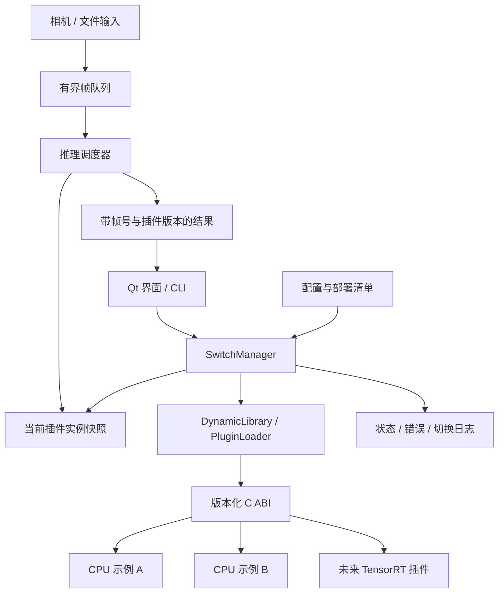
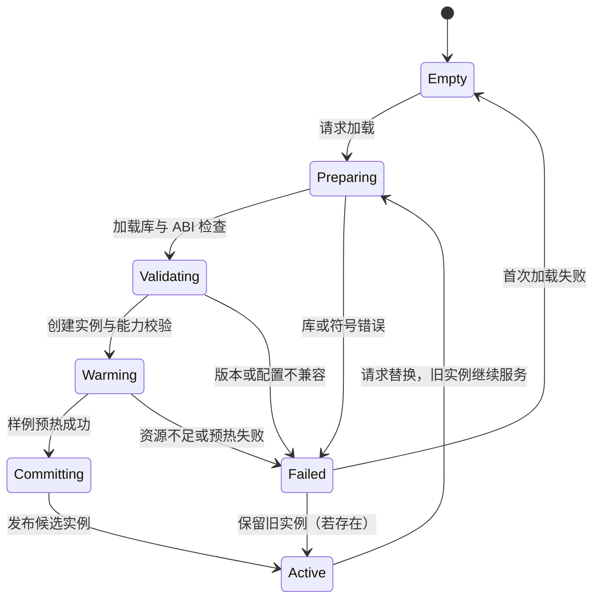

# 算法动态库切换框架

状态：设计提案。以已有 C++/Qt 加载器为起点，以下新目录、API 与切换机制尚未实现。

## 1. 边界与目标

第一阶段只解决同一输入输出契约下的插件替换，例如检测算法 A 切到检测算法 B。检测切分割或 OCR 涉及结果类型和展示器变化，需要能力协商，不应仅换一个库名。

成功标准：宿主不直接依赖具体推理引擎；插件失败可诊断；切换失败保留旧实例；在途调用与卸载之间具有明确同步协议。插件崩溃隔离不在进程内 DLL 的保证范围，需要进程外 worker 才能进一步处理。

## 2. 分层结构



| 模块 | 责任 | 不承担 |
|---|---|---|
| plugin_sdk | ABI、状态码、缓冲描述、版本与能力声明 | Qt、STL 或推理引擎依赖 |
| DynamicLibrary | RAII 库句柄、符号查找、错误上下文 | 模型初始化 |
| PluginInstance | 绑定函数表、实例与库句柄，按顺序销毁 | UI 控制 |
| PluginLoader | 校验版本和必需函数，创建候选实例 | 发布切换 |
| SwitchManager | 串行化切换、候选预热、提交或回滚 | 持有长时间全局推理锁 |
| Pipeline | 队列边界、帧号、请求取消与超时状态 | 插件实现细节 |
| Application | 配置、用户操作、状态和结果展示 | 绕过运行时直接卸载库 |

## 3. 建议目录

```text
plugin_sdk/include/algorithm_plugin.h   # 无 Qt/STL 的公共 ABI
runtime/src/dynamic_library.cpp        # 可先封装 QLibrary
runtime/src/plugin_instance.cpp        # 库句柄必须活得比实例长
runtime/src/plugin_loader.cpp
runtime/src/switch_manager.cpp
pipeline/src/frame_queue.cpp
apps/cli/                             # 首先验收无 GUI 链路
apps/desktop/                         # 后续 Qt 界面
plugins/cpu_reference_a/
plugins/cpu_reference_b/
plugins/tensorrt/                      # 后续可选依赖
configs/plugins/                      # 库路径、版本、能力、设备、模型路径
samples/                              # 可复现输入与预期结果
tests/                                # 加载、切换、生命周期与错误路径测试
```

迁移时保留现有目录作为 legacy；先建立独立 CMake targets，避免一次性重写所有历史模块。默认构建 CPU 示例，Qt GUI、CUDA 和 TensorRT 都由选项启用，不能成为 SDK 的硬依赖。

## 4. 接口契约

已有 `CreateInferImpl` 返回 C++ 虚对象，结果包含 `std::vector`、`std::string`。即使导出函数使用 C 链接名，仍会受编译器、运行库和对象布局影响。建议在宿主边界使用 C ABI；插件内部仍可自由使用 C++。

建议单一入口 `algorithm_get_api(requested_version, api_out)`，返回带 `struct_size` 与 `abi_version` 的函数表：

| 函数 | 语义 |
|---|---|
| get_info | 返回稳定存储的名称、版本与支持的任务类型 |
| create | 以配置创建 opaque handle；失败时不发布半初始化对象 |
| warmup | 对约定形状预热；返回状态和耗时 |
| infer | 同步借用输入，使用宿主提供的输出缓冲 |
| destroy | 释放插件实例，由创建它的模块负责释放资源 |
| get_last_error | 拷贝错误文本到调用方缓冲，禁止返回短命引用 |

所有函数返回状态码，异常必须在插件内部捕获。SDK 明确调用约定与导出宏；不跨边界传递 STL 容器、Qt 对象或 C++ 异常。图像描述至少包含宽高、像素格式、行步长和数据长度；所有长度与乘法计算检查溢出。输出容量不足返回所需容量及明确状态，不写越界。

首版采用同步推理，输入内存在函数返回前有效；插件不可保存输入裸指针。异步和 GPU 零拷贝是独立的后续 ABI 版本，不能隐含加入当前协议。

## 5. 切换协议



1. 切换请求携带唯一 request_id，串行化管理操作；首版忙时拒绝第二次请求，避免未定义竞争。
2. 旧插件继续处理已接受的帧；候选插件独立加载、初始化和预热。
3. 提交时只短暂锁住活动槽，交换 `shared_ptr<PluginInstance>`，增加 generation。
4. 每次推理先获得实例快照，调用期间保持引用；结果记录 frame_id、generation、算法版本，便于界面识别切换前后的结果。
5. 旧实例没有在途引用后才能 destroy，再卸载库。不能先卸载库再等推理结束。
6. 候选失败只销毁候选，发布失败原因，保持旧槽不变。初始化和预热超时应停止发布；线程内不合作的阻塞调用无法被安全强杀，需后台隔离或进程方案。

GPU 显存不足以同时容纳两个模型时，事务式双实例切换可能不可行。部署清单应明确选择“有停顿释放后加载”策略，并提示加载失败会进入不可用态；不能宣称此策略具有无损回滚能力。

## 6. 数据流与队列

采集帧携带时间戳、帧号、像素格式和所有权。使用有界队列，预览模式可以丢旧帧，批处理模式则显式背压；容量和策略写入配置。首版每个插件实例由一个推理工作线程使用，未声明线程安全的后端不得并发调用。

结果对象区分成功、取消、丢弃和失败。展示器按任务类型消费结果；不把检测、分割、OCR 强行压到一个未经定义的浮点数组中。

## 7. 验证矩阵

| 场景 | 预期 |
|---|---|
| 两个 CPU 插件对同一帧输出不同确定性结果 | 能证明真实动态库切换，而非配置字段变化 |
| 缺失库、缺失符号、ABI 不兼容 | 明确错误，无部分实例泄漏 |
| 插件初始化或预热失败 | 旧实例仍可用，候选资源回收 |
| 推理执行中提交切换 | 当前调用完成前不卸载旧库；新帧使用新 generation |
| 连续切换 1000 次 | 句柄/对象计数回到稳定值；结合工具检查内存增长 |
| 坏图像长度、行步长、输出容量不足 | 有界失败，不读写越界 |
| GUI 退出和后台切换重叠 | 停止接收帧，等待调用退出，按顺序释放 |
| 显存不足 | 不发布候选，报告失败或显式进入有停顿策略 |

记录环境、输入版本、预热/切换耗时和推理分位延迟；首阶段不承诺预设毫秒数。不能用 CPU 演示的延迟外推 GPU 实际部署。

## 8. 实施里程碑

- **M1：可独立构建的插件 SDK、运行时、CLI 和两个 CPU 插件。** 验收动态加载、结果可区分、重复加载释放和错误路径。
- **M2：事务式切换与生命周期测试。** 验收并发请求策略、失败回滚、在途调用保护、generation 跟踪。
- **M3：图像流水线与 Qt 展示。** 验收队列边界、丢帧策略、窗口关闭顺序和能力匹配。
- **M4：一个真实推理后端。** 明确模型、设备、驱动版本及部署路径，再扩展第二后端。

优先保留宿主协议和可复现测试，不同时推进所有任务类型和推理引擎。
